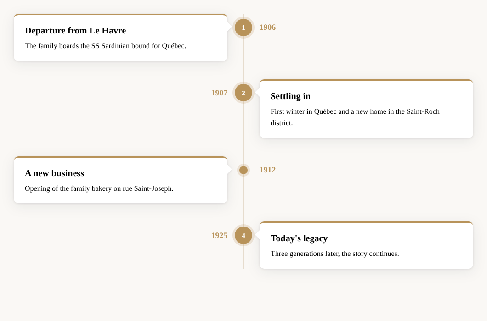
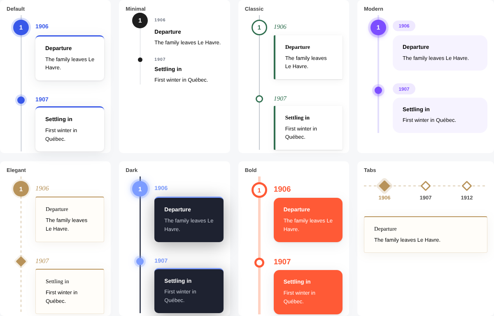

# WP Chrono timeline block

Lightweight Gutenberg block for WordPress to build **vertical** (one-sided or alternating), **horizontal** and **tabbed** timelines, with 7 themes, ready-made templates, icons, images, lightbox, custom colors and scroll animation. No build step, translation-ready (English / French).





## Features

- **5 layouts**: vertical alternating, vertical with the line on the left, vertical with the line on the right, horizontal (scrollable, swipe-friendly) and **tabs** (clickable date bar showing one event at a time, keyboard accessible)
- **Responsive**: the alternating layout automatically switches to one side on mobile
- **Dual orientation**: horizontal and tabbed timelines can switch to a vertical layout on phones
- **7 themes**: Default, Minimal, Classic, Modern, Elegant, Dark and Bold — each works with every layout, and your own colors override the theme
- **Templates**: preconfigured layout + theme combinations available straight from the block inserter (e.g. "Timeline – Elegant, alternating", "Timeline – Bold, tabs")
- **Events** with date, title, rich text and optional image
- **Markers**: dot, Dashicon (24 icons) or short text (number, letter, emoji), with a per-event accent color
- **Image click action**: none, full-size lightbox (with previous/next navigation, keyboard and screen-reader support) or open in a new tab
- **Styling**: line, dot, card, title and date colors (uses your theme palette), line thickness, dot size, card radius, spacing, shadow on/off
- **Date position**: opposite the card or above it
- **Scroll animation**, automatically disabled for users who prefer reduced motion
- **Theme-proof**: the timeline line does not rely on `::before`, so aggressive theme CSS can't hide it
- **Automatic updates from GitHub**: new releases show up in **Dashboard → Updates** like any other plugin, with one-click and auto-update support
- **Translation-ready**: English source strings, French translation included (`fr_FR`), `.pot` template provided

## Requirements

- WordPress 6.3 or later
- PHP 7.4 or later

## Installation

1. Download this repository as a ZIP (**Code → Download ZIP**).
2. In WordPress, go to **Plugins → Add New → Upload Plugin**, choose the ZIP and click **Install Now**, then **Activate**.

You can also copy the folder directly into `wp-content/plugins/`.

## Updates

The plugin checks this repository's [releases](https://github.com/cedlelensois-lang/WP-Chrono-timeline-block/releases) twice a day (results are cached for 6 hours) and offers the update in WordPress like any plugin from WordPress.org. You can also click **Check for updates** under the plugin name on the Plugins screen to check immediately, and enable **auto-updates** there.

**Publishing a new version:**

1. Bump `Version:` and `CTB_VERSION` in `chrono-timeline-block.php`, and add a `### x.y.z` entry to the changelog below.
2. Commit and push.
3. Push a tag with the version number (e.g. `v1.4.2` or `1.4.2`).

The **Release** GitHub Action (`.github/workflows/release.yml`) then checks that the tag matches the plugin version, builds `chrono-timeline-block.zip` (plugin files only), and publishes the GitHub release with the zip attached and the changelog entry as release notes.

Pre-releases and drafts are ignored. The `Update URI` header guarantees WordPress.org is never queried for this plugin.

## Usage

1. In the block editor, type `/timeline` (or `/frise`) and insert the **Timeline** block.
2. Select an event to edit its date, title and text, add an image from the toolbar, and pick a marker and accent color in the sidebar.
3. Select the parent **Timeline** block (use the "Select parent" button or the List View) to pick a theme and change the layout, colors and dimensions.
   Tip: search for "Timeline –" in the inserter to start from a ready-made template.
4. Click **Add an event** under the timeline to add more steps.

## Translations

The interface follows the site language (or the user's profile language).

| Language | Status |
| --- | --- |
| English | Built-in (source) |
| French (`fr_FR`) | Included |

To add a language, start from `languages/chrono-timeline-block.pot` using Poedit or Loco Translate. JavaScript strings also need a JSON file (`chrono-timeline-block-{locale}-ctb-editor.json`), which `wp i18n make-json` can generate.

## File structure

```
chrono-timeline-block.php   Plugin bootstrap (registers scripts, styles, blocks, translations)
blocks/timeline/            Parent block metadata (block.json)
blocks/timeline-item/       Event block metadata (block.json)
assets/editor.js            Editor UI for both blocks (no build step required)
assets/editor.css           Editor-only styles
assets/style.css            Front-end and editor styles
assets/view.js              Front-end scroll animation and lightbox
languages/                  .pot template and French translation (.po, .mo, .json)
```

## Changelog

### 1.4.2
- Releases are now built and published automatically by a GitHub Action when a version tag is pushed (plugin zip attached)


### 1.4.1
- Plugin renamed to "WP Chrono timeline block" in the WordPress admin


### 1.4.0
- Automatic updates from GitHub releases (with "Check for updates" link, release notes in "View details", auto-update support)


### 1.3.0
- New tabs layout (one event at a time, with clickable date bar)
- Dual orientation option: horizontal / tabs on desktop, vertical on mobile
- 7 themes (Default, Minimal, Classic, Modern, Elegant, Dark, Bold) with a visual picker
- 7 ready-made templates in the block inserter


### 1.2.0
- Bilingual interface: English source strings with bundled French translation

### 1.1.1
- Fix: timeline line hidden by some themes
- Fix: white gap around the card arrow

### 1.1.0
- Image click action: lightbox or open in a new tab

### 1.0.0
- Initial release

## License

GPL-2.0-or-later. See [LICENSE](LICENSE).
